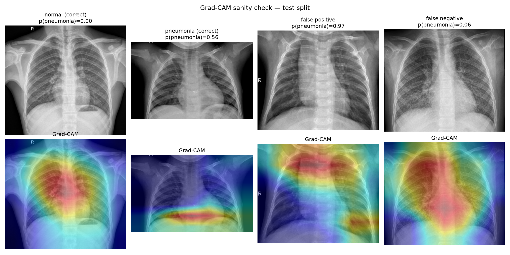
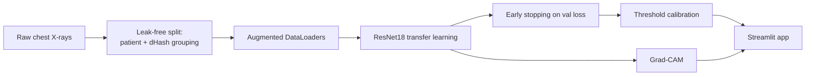
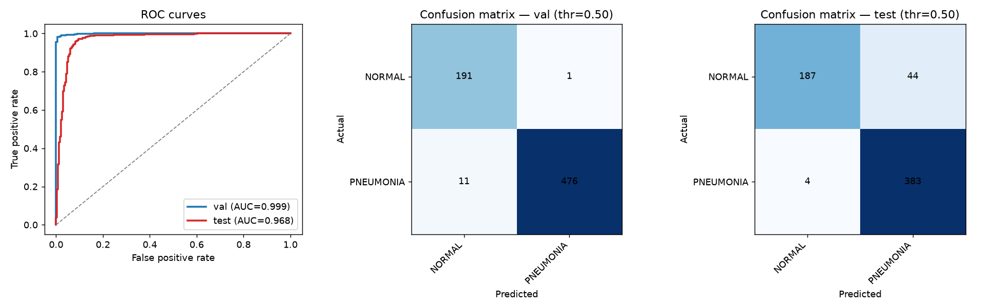
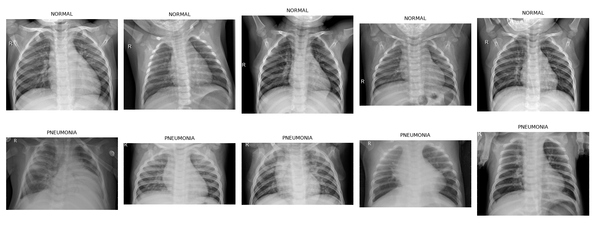
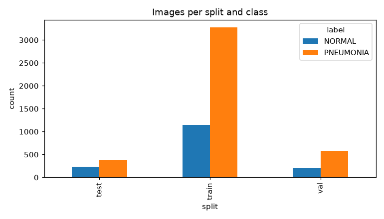
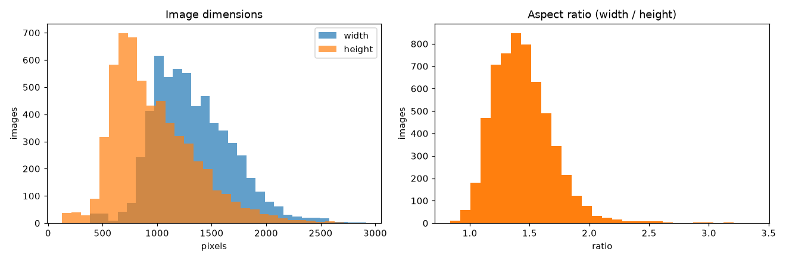

# chest-xray-pneumonia-cv


End-to-end chest X-ray pneumonia classification with a fine-tuned ResNet18,
Grad-CAM explanations, and a Streamlit demo.



*Correct normal, correct pneumonia, a false positive, and a false negative on
the held-out test split. The heatmaps concentrate on the lung fields and
cardiomediastinal silhouette rather than image borders or text markers.*

---

## What is pneumonia?

Pneumonia is an infection that inflames the air sacs (alveoli) in one or both
lungs. The sacs may fill with fluid or pus, which is what causes the cough,
fever, chest pain, and difficulty breathing. It is usually caused by:

* **bacteria** (for example *Streptococcus pneumoniae*) — often the most severe;
* **viruses** (for example RSV or influenza) — very common in young children;
* **fungi** — rare, mostly in people with weakened immune systems.

On a chest X-ray, pneumonia typically appears as an area of increased density —
consolidation, infiltrates, or opacities — where the air-filled lung should look
dark. Radiologists diagnose it by looking for those regional patterns.

Reading chest X-rays is repetitive, and early findings can be subtle and are
subject to observer variability. A model that flags suspicious films and
explains *where* it is looking can help prioritise review. It does **not**
replace a clinician — this repository is an educational project, not a medical
device.

## The problem

Building this classifier surfaced four concrete difficulties:

1. **Class imbalance.** About 70% of images are pneumonia, so plain accuracy is
   misleading and a model can score well by biasing toward the majority class.
2. **Subtle, diffuse findings.** Bacterial and viral pneumonia do not appear as a
   single tidy object; they are spread across a lung field, which makes the task
   harder than a typical object-recognition problem.
3. **Silent data leakage.** A naive random split put the *same patients* and
   near-duplicate images in both train and validation. The first model reached
   **99.4% validation accuracy but only 73.5% on the official test set** —
   validation was measuring memorisation, not generalisation.
4. **Trust / black-box behaviour.** A number alone is not useful to a clinician;
   the model needs to show the evidence behind a prediction.

## The approach



* **Leak-free data split** — images are grouped by patient/study identifier and
  by a 255-bit perceptual hash, so near-duplicates never cross splits; any image
  sharing a patient with the test folder is dropped from training.
* **Augmentation** — random resized crop, horizontal flip, small rotation, and
  brightness/contrast jitter, normalised with ImageNet statistics.
* **Transfer learning** — ImageNet-pretrained ResNet18 with the classifier head
  replaced for two classes, trained with class-weighted, label-smoothed
  cross-entropy, AdamW, a cosine LR schedule, and early stopping.
* **Honest evaluation** — accuracy, precision, recall/sensitivity, F1, ROC-AUC,
  and a confusion matrix, plus a threshold calibration script.
* **Explainability** — Grad-CAM on the last convolutional block, with an
  attention gallery for qualitative checking.
* **Demo** — a Streamlit app that takes an uploaded X-ray, predicts, and shows
  the Grad-CAM overlay.

## Results

Metrics at the default 0.5 decision threshold
(`python scripts/evaluate.py --split val|test`):

| Split | Accuracy | Precision | Recall (sensitivity) | F1 | ROC-AUC |
|-------|----------|-----------|----------------------|----|---------|
| val   | 0.9823   | 0.9979    | 0.9774               | 0.9876 | 0.9989 |
| test  | 0.9223   | 0.8970    | 0.9897               | 0.9410 | 0.9684 |



On the test split the model misses only **4 of 387** pneumonia cases (98.97%
recall) with 89.70% precision. Validation is a genuinely leak-free estimate, and
the test column is the harder, shifted official Kaggle test folder.

> **Framing note.** The validation number should not be read as real-world
> performance. The Kaggle folders carry an acquisition bias (normal images are
> larger/higher-resolution than pneumonia images), so in-distribution validation
> is optimistic. Because that bias is much weaker on the official test set, the
> test metrics are the more trustworthy headline.

## Dataset

[Chest X-Ray Images (Pneumonia)](https://www.kaggle.com/datasets/paultimothymooney/chest-xray-pneumonia)
(Kermany et al.). Anterior-posterior chest X-rays of pediatric patients (one to
five years old) collected at the Guangzhou Women and Children's Medical Center.







`scripts/make_splits.py` merges the original tiny `val` folder into the training
pool and rebuilds a **leak-free** split:

* exact duplicates removed by MD5;
* images grouped by patient/study identifier parsed from the filename;
* near-duplicates grouped with a 255-bit difference hash;
* pooled images sharing a patient with the test folder are dropped.

The result is a seeded, class-stratified group split with **zero patient
overlap** between splits:

| Split | Images | NORMAL | PNEUMONIA |
|-------|--------|--------|-----------|
| train | 4,074  | 1,156  | 2,918     |
| val   | 679    | 192    | 487       |
| test  | 618    | 231    | 387       |

The raw images are not redistributed in this repository (`data/` is git-ignored);
download them from Kaggle and place them under `data/raw/`.

## Installation

```bash
git clone https://github.com/Moudjib16/chest-xray-pneumonia-cv.git
cd chest-xray-pneumonia-cv

python -m venv venv
venv\Scripts\activate            # Windows
# source venv/bin/activate       # macOS / Linux

pip install -r requirements.txt
```

Download the dataset from Kaggle and lay it out as:

```
data/raw/
├── train/
│   ├── NORMAL/*.jpeg
│   └── PNEUMONIA/*.jpeg
├── val/
└── test/
    ├── NORMAL/*.jpeg
    └── PNEUMONIA/*.jpeg
```

`scripts/make_splits.py` rebuilds `data/splits.csv` from this layout, so the
original `train`/`val` folders are pooled automatically. Training initialises
ResNet18 with ImageNet weights, which are downloaded on first use and cached
afterwards.

## Usage

```bash
# build the leak-free splits and verify the pipeline
python scripts/make_splits.py
python scripts/sanity_check.py

# train (CPU profile by default; --profile gpu and --epochs N also supported)
python src/train.py --profile cpu

# evaluate the best checkpoint
python scripts/evaluate.py --split test

# pick a decision threshold on validation
python scripts/calibrate.py --split val

# render the Grad-CAM gallery
python scripts/gradcam_gallery.py --split test

# tests
pytest -q

# run the demo
streamlit run app/main.py
```

Hyperparameters, split paths, and the decision threshold live in
`configs/config.yaml`. The best checkpoint is written to
`models/resnet18_xray.pth`.

## Project structure

```
app/main.py             Streamlit upload-and-explain demo
configs/config.yaml     paths, hyperparameters, CPU/GPU profiles
docs/                   README figures
notebooks/01_eda.ipynb  exploratory data analysis
scripts/make_splits.py  leak-free split: patient + dHash grouping
scripts/sanity_check.py validate paths, overlaps, and batch loading
scripts/evaluate.py     metrics + confusion matrix
scripts/calibrate.py    decision-threshold selection
scripts/gradcam_gallery.py  Grad-CAM attention gallery
src/dataset.py          Dataset, transforms, DataLoaders
src/model.py            ResNet18 builder and Grad-CAM target layer
src/train.py            training loop with early stopping
src/gradcam.py          Grad-CAM heatmaps and overlays
tests/                  dataset, model, and Grad-CAM tests
```

## Limitations

* Trained and evaluated on a single pediatric dataset from one institution; it
  has **not** been validated on external data (for example NIH ChestX-ray14 or
  CheXpert).
* The dataset has a documented acquisition bias (image resolution and file size
  differ between classes), which inflates in-distribution validation.
* Results come from a single training run; no cross-validation spread is
  reported.
* Predicted probabilities are not perfectly calibrated; adjust the decision
  threshold for the sensitivity/specificity trade-off you need.
* Grad-CAM is indicative, not a causal explanation of the decision.

## Disclaimer

This is a research and portfolio project. It is **not** a medical device and
must not be used for clinical diagnosis or treatment decisions. Always consult a
qualified healthcare professional.

## Acknowledgements

* Dataset: [Chest X-Ray Images (Pneumonia)](https://www.kaggle.com/datasets/paultimothymooney/chest-xray-pneumonia)
  (Kermany et al., 2018), used here under its Kaggle terms.
* Model: ImageNet-pretrained ResNet18 from `torchvision`.
* Grad-CAM: Selvaraju et al., *Grad-CAM: Visual Explanations from Deep Networks
  via Gradient-based Localization* (2017).
